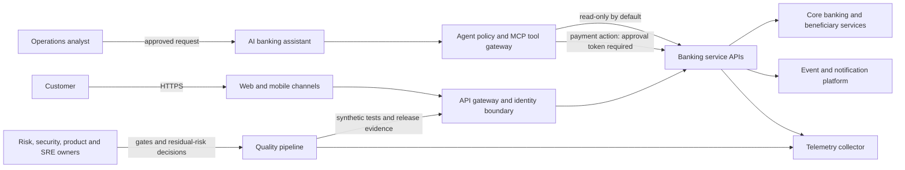
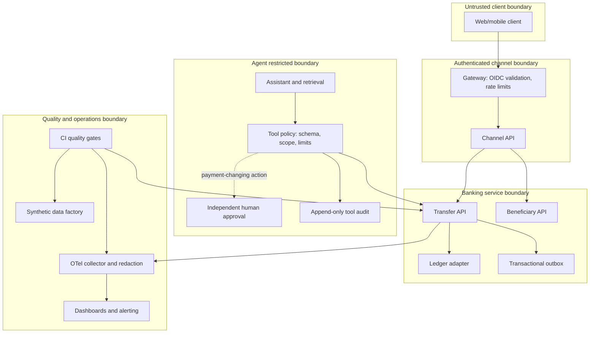
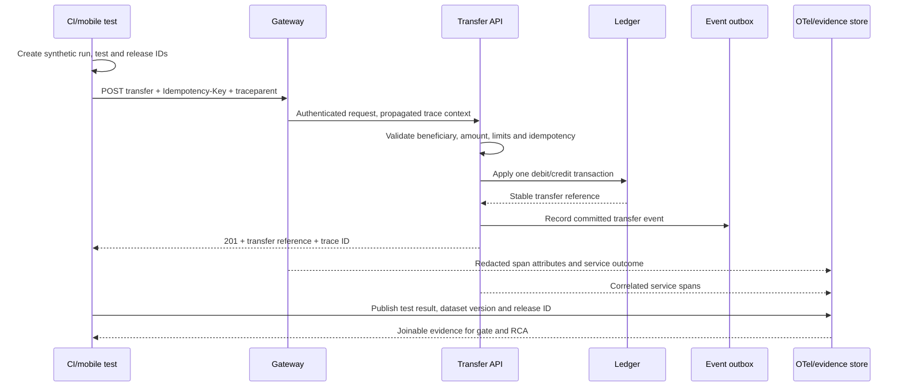
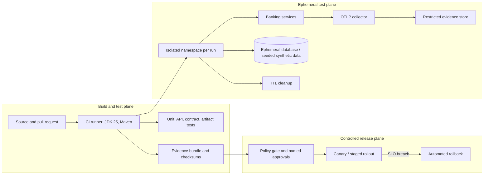

# ACE Target Architecture Views

Status: target-state design for the synthetic digital-banking reference application. The local Spring API is implemented; mobile, Kubernetes, cloud services, identity provider, event broker, and production telemetry are design boundaries, not deployed components.

## System context

## Containers and trust boundaries

Trust-boundary controls: clients never connect directly to ledger or tools; workload identity is checked at service entry; agent arguments are schema-validated and bounded; approvals are bound to the exact action and expire; sensitive fields are removed before telemetry export. Production identity, approval, ledger and durable audit integrations remain deployment requirements.

## Transfer sequence and evidence join

The evidence join key is `trace_id` plus `test_run_id`, `test_case_id`, `release_id`, `service.name`, and synthetic `dataset_version`. Do not attach account numbers, beneficiary names, tokens, full prompts, or payment amounts to span attributes. The local example uses an in-process logging exporter; this diagram describes the target OTLP deployment.

## Deployment view

The workflow in this repository verifies the local Maven project and uploads CI artifacts. Ephemeral namespace provisioning, cloud IAM, a database service, evidence-store retention, canary and rollback automation require platform implementation before production use.

## Architecture decisions to ratify

| Decision | Current direction | Required production decision |
| --- | --- | --- |
| Payment-changing agent tools | Separate approval, narrow allow-list, immutable audit | Select identity-bound approval and durable audit products; threat-model replay and expiry |
| Test environments | Isolated and synthetic, short-lived | Select Kubernetes namespace/cluster tenancy, secrets source, network policy, TTL controller |
| Telemetry | W3C trace context and OTel | Select authenticated collector, storage, retention, redaction and access policy |
| Release | Deterministic mandatory gates; AI advisory only | Integrate policy engine and signed evidence with deployment controller |
